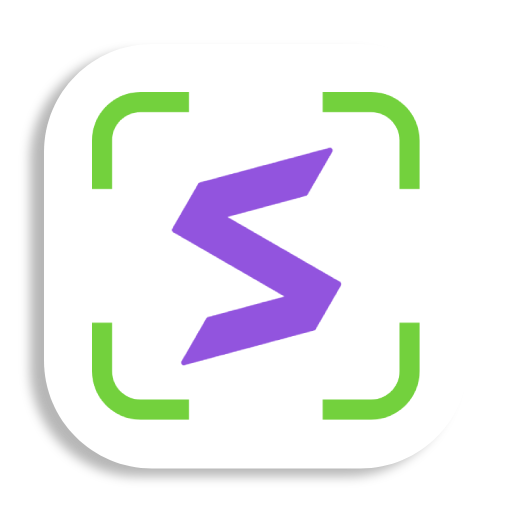
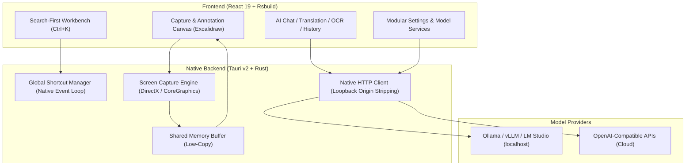

# Snow Shot

<p align="center">
  
</p>

<p align="center">
  <strong>A local-first screenshot, annotation, pinning, and AI workspace for Windows and macOS.</strong>
</p>

<p align="center">
  <a href="https://github.com/llw2011/snow-shot/releases"></a>
  <a href="https://github.com/llw2011/snow-shot/actions"></a>
  <a href="https://tauri.app"></a>
  <a href="https://www.rust-lang.org"></a>
  <a href="https://react.dev"></a>
  <a href="https://github.com/llw2011/snow-shot/blob/main/LICENSE-Commercial"></a>
</p>

---

## Overview

**Snow Shot** is an open-source desktop utility for screenshots, image pinning, canvas annotation, and local AI assistance. It is built with **Tauri v2**, **Rust**, and **React 19**.

Everything runs locally on your computer. Your captured images, clipboard data, annotations, and OCR results remain on your machine unless you choose to send prompts to an external API endpoint.

This repository is an enhanced fork of [mg-chao/snow-shot](https://github.com/mg-chao/snow-shot). Key improvements include:
- A search-first workbench with keyboard-first navigation (`Ctrl/Cmd+K`).
- Out-of-the-box support for local AI models (Ollama, vLLM, LM Studio) without CORS or loopback origin issues.
- Native Rust global shortcuts that stay reliable through Windows lock screen, sleep, and remote desktop sessions.
- Low-overhead shared memory buffers for handling multi-monitor and high-resolution screen captures.
- Dedicated standalone packages for offline and enterprise environments (bundled WebView2 fixed-runtime).

---

## Features

### 📸 Capture & Annotation
- **Smart Window Snapping**: Automatically detects active windows, toolbars, and controls.
- **Annotation Tools**: Rectangles, circles, arrows, freehand drawing, step counters, highlight markers, and text.
- **Privacy Masking**: Smooth blur and mosaic brushes to conceal sensitive information before sharing.
- **Embedded Excalidraw**: Built-in whiteboard canvas for diagrams, sketches, and visual notes.

### 📌 Pin to Screen (Stickers)
- **Floating Pins**: Pin any screenshot, graphic, or text snippet on top of other windows.
- **Controls**: Adjust transparency, scale with mouse wheel, toggle click-through, or copy images directly back to your clipboard.

### 📜 Scrolling Screenshot & Recording
- **Long Screenshot**: Scroll vertically through documents, code files, and web pages to generate a single continuous image.
- **Screen Recording**: Record designated screen regions with audio, and export as MP4 or animated GIF.

### 🤖 Local AI & Model Services
- **Unified Model Management**: Configure chat, translation, and OCR model endpoints in one centralized settings panel.
- **Auto-Detection**: Query `/v1/models` on local or remote servers to list available models automatically, test response latency, and check reachability.
- **Native Localhost Handling**: Strips the webview `Origin` header for loopback addresses (`localhost`, `127.0.0.1`, `[::1]`) so Ollama works directly without throwing HTTP 403 Forbidden.
- **Provider Support**: Works with Ollama, vLLM, LM Studio, LocalAI, and any OpenAI-compatible remote API.

### ⚡ Search-First Workbench
- **Command Palette (`Ctrl/Cmd+K`)**: Quick launcher to trigger tools, actions, or jump straight to specific settings without digging through menus.
- **Modular Settings**: Structured categories for Capture, Shortcuts, Recording, AI Services, and System preferences.
- **Consistent Navigation**: Dedicated tool pages (Chat, Translation, Capture History) feature explicit back navigation, Esc shortcuts, and window controls.

---

## Comparison with Upstream (mg-chao/snow-shot)

| Area | Upstream (`mg-chao/snow-shot`) | This Fork (`llw2011/snow-shot`) |
|---|---|---|
| **Interface & Navigation** | Long single-column settings form; secondary tool pages lack clear back navigation. | **Search-first workbench (`Ctrl/Cmd+K`)**, categorized modular settings, and uniform return navigation across all views. |
| **Local LLM Integration** | Manual text input for model names; no endpoint health checks. | **Unified Model Services** with auto-probe (`/v1/models`), latency testing, and zero-config local Ollama header handling. |
| **Windows Background Stability** | Hotkeys can become unresponsive after screen lock, sleep, or RDP session changes. | **Native Rust shortcut holder** with session event listening and automatic recovery upon system wake/unlock. |
| **Large Image IPC** | High-res images transferred across IPC via Base64, which can cause memory spikes. | **Shared memory buffer** for fast, low-copy transfer between the native capture engine and the webview. |
| **Enterprise & Offline Use** | Requires system WebView2 runtime; cannot run on air-gapped or restricted machines. | **Fixed-runtime installer** (bundles WebView2) and full **offline bundles** that require no internet connection. |
| **Releases & OTA Updates** | Single-platform build script. | **Multi-platform GitHub Actions CI matrix** with two-phase Minisign signing, `checksums.json`, and CDN convergence verification. |

---

## System Architecture



---

## Download & Installation

Pre-built binaries for Windows and macOS are available on the [GitHub Releases](https://github.com/llw2011/snow-shot/releases) page:

| Package | Intended Environment | File Pattern |
|---|---|---|
| **Windows Standard Setup** | Everyday Windows 10/11 systems with system WebView2 | `Snow.Shot_<ver>_windows-x64_setup.exe` |
| **Windows Fixed Runtime** | Enterprise, government, or legacy systems without WebView2 | `Snow.Shot_<ver>_windows-x64_webview_setup.exe` |
| **Windows Offline Setup** | Isolated / air-gapped environments with all dependencies included | `Snow.Shot_<ver>_windows-x64_offline_setup.exe` |
| **macOS Apple Silicon** | Mac machines with Apple Silicon (M1 / M2 / M3 / M4) | `Snow.Shot_<ver>_darwin-aarch64.dmg` |
| **macOS Intel** | Mac machines with Intel 64-bit processors | `Snow.Shot_<ver>_darwin-x64.dmg` |

> [!NOTE]
> Releases and automatic updates are verified with digital Minisign signatures. Because this is an independent open-source project without a paid commercial certificate, Windows SmartScreen or macOS Gatekeeper may show a warning on first launch.
> - **Windows**: Click "More info" -> "Run anyway".
> - **macOS**: Right-click the application icon and select "Open".

---

## Connecting to Local Ollama

Snow Shot connects directly to your local Ollama instance (`http://localhost:11434` or `http://127.0.0.1:11434`).

Desktop webviews usually send an `Origin: http://tauri.localhost` header, which causes Ollama to respond with `HTTP 403 Forbidden` unless the user manually configures `OLLAMA_ORIGINS`.

Snow Shot automatically handles this at the native transport level:
1. For loopback addresses (`127.0.0.1`, `localhost`, and `[::1]`), the request `Origin` header is stripped before sending.
2. You do **not** need to set `OLLAMA_ORIGINS="*"`.
3. You do **not** need to restart your Ollama service.
4. Remote API endpoints remain unchanged and adhere to standard origin headers.

**Setup Steps**:
1. Open Snow Shot and press `Ctrl/Cmd+K`, then select **Model Services** (or go to Settings -> Model Services).
2. Enter your Ollama endpoint URL (default: `http://localhost:11434`).
3. Click **Detect Models** — Snow Shot will query `/v1/models`, test the round-trip latency, and populate your available model dropdown.
4. Select your preferred model for Chat or Translation.

---

## Building from Source

### Prerequisites

- **Node.js**: 22+
- **Package Managers**: pnpm 10+ and Yarn 1.x
- **Rust**: 1.90+ (`rustup update stable`)
- **Native Toolchains**:
  - Windows: Visual Studio Build Tools (C++ x64/x86 tools), Windows 10/11 SDK, NSIS
  - macOS: Xcode Command Line Tools (`xcode-select --install`)

### Setup & Development

The drawing canvas relies on [`mg-chao/excalidraw`](https://github.com/mg-chao/excalidraw) (branch `custom/master`) located in a sibling directory:

```bash
# 1. Clone the repository and the Excalidraw submodule in the same parent folder
git clone https://github.com/llw2011/snow-shot.git snow-shot
git clone --branch custom/master https://github.com/mg-chao/excalidraw.git excalidraw

# 2. Build the Excalidraw dependency
cd excalidraw
yarn install --frozen-lockfile

# 3. Install Snow Shot dependencies
cd ../snow-shot
pnpm install --frozen-lockfile
pnpm update:excalidraw

# 4. Start local development
pnpm dev                 # Starts the frontend development server (Rsbuild)
pnpm dev:tauri           # Starts the hybrid desktop app (Tauri + Rust)
```

### Running Tests & Building Releases

```bash
# Run unit and regression tests
pnpm test:model-services # Test model service configuration logic
pnpm test:model-http     # Test loopback origin handling and HTTP transport
pnpm test:release        # Verify release and updater configuration

# Production builds
pnpm build               # Build production frontend assets
pnpm build:tauri         # Build desktop installer packages via Tauri
```

---

## Privacy & Security

- **No Data Collection**: Release binaries contain zero telemetry scripts, analytics beacons, or private third-party trackers.
- **Local Storage**: All captured images, OCR text, annotation metadata, and conversation histories are stored locally on your device.
- **Verified Updates**: The built-in updater only checks official GitHub Releases and validates digital signatures using Minisign before applying updates.

---

## License & Acknowledgments

- Snow Shot is derived from [mg-chao/snow-shot](https://github.com/mg-chao/snow-shot). Many thanks to **mg-chao** and all upstream contributors for their foundational work.
- The repository is released under a dual-license model:
  - Commercial Use: [`LICENSE-Commercial`](LICENSE-Commercial)
  - Non-Commercial Use: [`LICENSE-NonCommercial`](LICENSE-NonCommercial)
