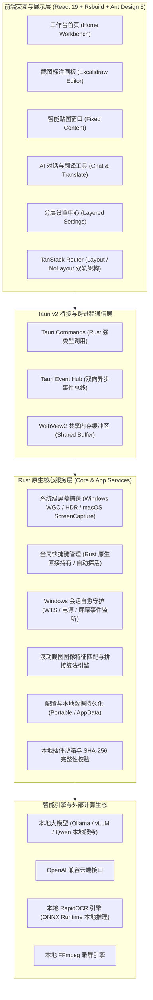
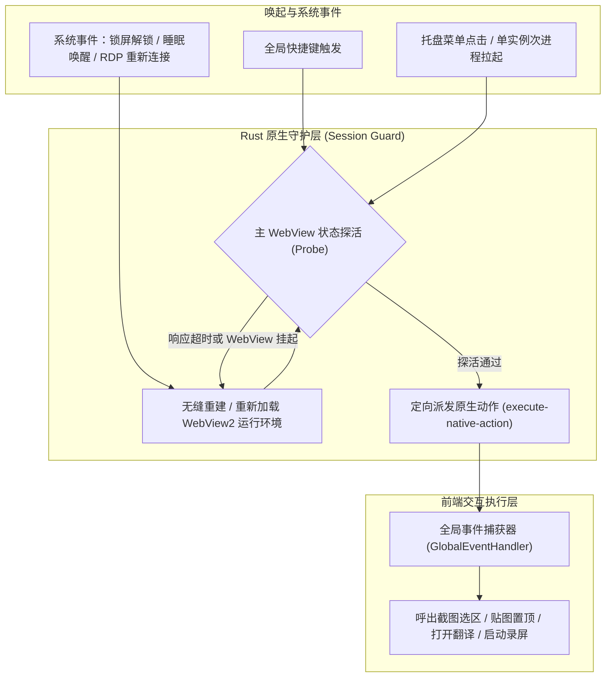
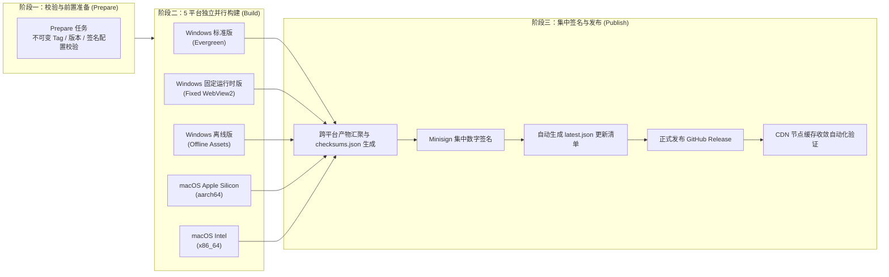

# Snow Shot

<p align="center">
  
</p>

<p align="center">
  <strong>面向 Windows 与 macOS 的现代化本地优先截图与 AI 生产力工作台</strong><br>
  <sub>A modern, local-first screenshot workspace and AI productivity toolkit for Windows and macOS.</sub>
</p>

<p align="center">
  <a href="https://github.com/llw2011/snow-shot/releases"></a>
  <a href="https://github.com/llw2011/snow-shot/actions"></a>
  <a href="https://tauri.app"></a>
  <a href="https://www.rust-lang.org"></a>
  <a href="https://react.dev"></a>
  <a href="https://github.com/llw2011/snow-shot/blob/main/LICENSE-Commercial"></a>
</p>

---

## 📖 项目简介

**Snow Shot** 是一款面向桌面端深度打磨的高性能截图、标注、贴图与 AI 生产力工作台。项目基于 **Tauri v2 + Rust + React 19** 构建，坚持**本地优先（Local-First）与隐私自治**原则。

本项目作为深度增强演进分支（Fork 自 [mg-chao/snow-shot](https://github.com/mg-chao/snow-shot)），不仅全面重构了符合人类心智与操作习惯的卡片化交互界面，深度整合了本地大模型（Ollama / vLLM / Qwen）的智能识别与极速翻译能力，更针对 Windows 7×24 小时长期后台驻留、长截图稳定性、跨进程大图传输性能以及多架构全自动 OTA 升级机制进行了系统性的工业级硬化。

---

## ⚡ 与原官方版本（Upstream: mg-chao/snow-shot）的核心差异

为满足复杂生产环境（包括完全离线/政企内网环境、本地私有化大模型联动、长期后台免维护运行等高可靠场景），本项目在原版基础上进行了全方位的架构重构与能力升级：

### 1. 核心维度横向对比

| 功能维度 | 原官方版本 (Upstream) | 本项目增强版 (llw2011/snow-shot) |
|---|---|---|
| **界面交互 (UI/UX)** | 传统单列长表单排版，主功能层级深；二级对话/工具页面无显式返回导航 | **全新卡片化工作台（Workbench）**，功能区块化、快捷键状态一目了然；**设置中心多级结构化重构**；对话与工具页面标配**统一返回导航**（返回按钮、Esc 快捷键、窗口控制及拖拽区域） |
| **本地大模型支持** | 仅支持固定配置；模型名称须手动精准输入，无预检机制 | **智能模型探针（Model Probe）**：自动抓取 `/v1/models` 本地/远程模型列表；**内置连通性测试与延迟测速**；请求去抖中断与本地 LRU 缓存 |
| **Windows 驻留稳定性** | 锁屏/睡眠/待机唤醒或 RDP 断开后，快捷键易失效或 WebView 假死 | **Rust 原生持有全局快捷键**（不依赖 JS 桥接）；**会话与渲染器自愈守护**（WTS/电源事件唤醒后自动探活与重建） |
| **大图内存与 IPC 通信** | 高清/多屏截图通过 Base64/常规 IPC 传输，偶发内存暴涨或 IPC 阻塞 | **WebView2 共享内存缓冲区（Shared Buffer）**：零拷贝/低拷贝内存直通；严格限定超时回收与清理兜底 |
| **离线与政企环境适配** | 强依赖系统已安装的 WebView2 运行时，无网/老旧环境无法启动 | **提供内置 WebView2 固定运行时版本（Fixed Runtime）**，无需联网下载依赖，开箱即用；提供完整离线资源包 |
| **多端发布与 OTA 更新** | 基础发布脚本，多平台构建与更新存在碎片化和 CDN 缓存陷阱 | **工业级五平台并行 CI/CD 矩阵**；两阶段集中签名（Minisign）与 `checksums.json`；**自动验签与 CDN 收敛检测** |
| **主题与视觉质感** | 基础浅色/深色模式，部分透明圆角窗口存在黑边与文字发虚 | **多套专属调优主题**（雪原 Snowfield、极简黑白 Monochrome 等）；透明抗锯齿裁剪优化；字体渲染清晰度提升 |

---

### 2. 五大核心演进深度解析

#### 1. 深度整合本地大模型生态 (Local LLM & Ollama)
- **智能模型探针**：在翻译与 AI 对话设置中，输入本地 Ollama / vLLM 接口地址后，可自动探测并读取可用的本地模型清单，告别手动查阅与繁琐复制。
- **即时连通性与测速**：提供一键连通性测试，实时显示接口往返耗时（RTT）及测试文本翻译结果，连通状态与效果一目了然。
- **高并发防抖与 Abort 控制**：在连续翻译或多段文本处理中，通过 `AbortController` 及时终止已作废的旧请求，并配合本地 LRU 缓存，极大降低本地 GPU 负担。

#### 2. 人类心智导向的现代化 UI 重构
- **卡片式快捷工作台**：首页从传统扁平列表升级为分区清晰的响应式卡片网格，快捷键触发状态直观可见，常用功能触手可及。
- **分层设置中心**：将杂糅的选项划分为常规、截图/标注、OCR/AI 翻译、快捷键与高级系统设置，支持配置草稿实时暂存。
- **全局统一的导航回退机制**：AI 对话和翻译子窗口配备标准的显式返回键、`Esc` 快速退回、统一的拖拽区域与窗口控制按钮，符合桌面软件操作直觉。

#### 3. Windows 7×24 小时后台驻留可靠性硬化
- **原生快捷键探活自愈**：全局快捷键直接由 Rust 通过操作系统底层 API 注册，不依附于前端 WebView 的 JavaScript 运行时。
- **防休眠与 RDP 恢复机制**：监听 Windows 锁屏/解锁、电源状态切换与远程桌面（RDP）断开重连，在 WebView 挂起或丢失上下文时主动发起探活并无缝重建，确保截图呼之即来。
- **HDR 与长截图超时兜底**：Windows HDR 截图增加 5 秒安全超时限制，失败时自动优雅回退至 SDR 模式；长截图严格控制拼接内存分配，避免大图拼接崩溃。

#### 4. 真正免依赖的离线发行版 (Fixed Runtime)
- **开箱即用**：针对政企专网、金融内网或禁用 Edge/WebView2 自动更新的严苛环境，专门打造了打包固定 WebView2 Runtime 的独立安装包。
- **离线 OCR 与资源内置**：RapidOCR 搭配本地 ONNX Runtime 引擎，无需向任何公网服务器上传截图图像，完全在本地单机离线运行。

#### 5. 集中签名与防篡改的 OTA 自动化升级体系
- **多平台矩阵构建**：单次版本发布覆盖 macOS (Apple Silicon / Intel) 与 Windows (标准版 / 离线版 / 固定运行时版) 共 5 个平台目标。
- **两阶段安全发布架构**：构建阶段无权发布 Release；最终由专属 Publish 阶段集中收集全部产物，统一计算 SHA-256 哈希清单（`checksums.json`），并使用 Minisign 密钥签名。
- **智能 CDN 收敛校验**：自动化监测 GitHub Releases 与 CDN 缓存收敛情况，彻底杜绝客户端更新时因 CDN 节点延迟引起的 404 或死循环更新。

---

## 🏛️ 系统架构设计

### 1. 全局分层架构全景图



---

### 2. 核心运行时与原生快捷键可靠性链路

传统 Electron 或 Tauri 应用常因长时间后台静默导致 WebView 被系统挂起或丢帧。本项目采用 **Rust 原生守护与探活自愈机制**：



---

### 3. 多平台并行构建与两阶段集中签名流水线



---

## 🚀 功能特性全景

- **全场景截图**：支持自由选区截图、多显示器识别、活动窗口吸附、滚轮长截图及全屏截取。
- **专业标注工具箱**：集成 Excalidraw 画板核心，支持矢量箭头、矩形、椭圆、序号画笔、画线、文字以及马赛克/模糊涂抹。
- **贴图与固定置顶**：截取内容一键固定于桌面最上层（Pin），支持鼠标穿透、缩放、透明度调节与多图分组管理。
- **本地离线 OCR**：内置 RapidOCR（基于 ONNX Runtime），支持中英文及多语种精准本地文字提取，保障数据不上云。
- **本地 / 云端双模 AI 翻译**：
  - 支持调用本地 Ollama / vLLM 部署的开源大语言模型（如 Qwen2.5 等）。
  - 支持任何标准 OpenAI-compatible 云端接口。
  - 支持划词自动翻译、截图提取直译、分段防抖与历史缓存。
- **多模型 AI 对话**：内置便携对话面板，支持代码审查、截图答疑、图像描述等图文理解任务。
- **高清录屏**：支持选区录屏与系统声音采集，内置 FFmpeg 插件快速导出 MP4 / GIF。

---

## 📦 发行版本选择与下载

请前往 [GitHub Releases](https://github.com/llw2011/snow-shot/releases) 页面获取适合您操作系统环境的安装包：

| 发行包类型 | 适用环境 / 场景推荐 | 文件命名格式 |
|---|---|---|
| **Windows 标准安装版** | 绝大多数日常 Windows 10/11 用户，系统自带 WebView2 环境 | `snow-shot_<ver>_x64-setup.exe` |
| **Windows 便携免安装版** | 存放于 U 盘或移动存储中，配置和数据完全保存在当前目录（绿色便携） | 解压便携包，同级创建 `__portable` 目录即可 |
| **Windows 固定运行时版 (Fixed)** | **政企内网、隔离网络或未安装/无法更新 WebView2 的机器**（内置独立 WebView2） | `snow-shot_<ver>_x64-fixed-setup.exe` |
| **Windows 纯离线版 (Offline)** | 无法连接公网下载任何插件/依赖的严苛内网环境 | `snow-shot_<ver>_x64-offline-setup.exe` |
| **macOS Apple Silicon 版** | 搭载 M1/M2/M3/M4 系列芯片的苹果电脑（原生 aarch64） | `snow-shot_<ver>_aarch64.dmg` |
| **macOS Intel 版** | 搭载 Intel 处理器的传统苹果电脑（x86_64） | `snow-shot_<ver>_x64.dmg` |

> [!NOTE]
> 发布的 OTA 自动更新通过 Tauri 内置 Minisign 进行数字签名与防篡改验证。由于个人开源项目未购买商业代码签名证书，初次安装可能出现系统安全提示（如 Windows SmartScreen），选择“仍要运行”即可。

---

## 🛠️ 源码构建与本地开发

### 1. 环境准备

- **Node.js**：22+
- **包管理器**：pnpm 10+ 与 Yarn 1.x
- **Rust**：1.90+（建议使用 `rustup update` 升级到最新稳定版）
- **编译工具**：
  - Windows：Visual Studio Build Tools（包含 C++ x64/x86 生成工具）、Windows 10/11 SDK、NSIS
  - macOS：Xcode Command Line Tools

### 2. 代码克隆与 Submodule 依赖

画板编辑器使用与仓库同级的 [`mg-chao/excalidraw`](https://github.com/mg-chao/excalidraw)（分支 `custom/master`）：

```bash
# 1. 在同一父级目录下克隆主仓库与 Excalidraw 依赖
git clone https://github.com/llw2011/snow-shot.git snow-shot
git clone --branch custom/master https://github.com/mg-chao/excalidraw.git excalidraw

# 2. 编译 Excalidraw 画板依赖包
cd excalidraw
yarn install --frozen-lockfile

# 3. 安装 Snow Shot 依赖并进入开发模式
cd ../snow-shot
pnpm install --frozen-lockfile
pnpm update:excalidraw

# 4. 启动开发模式
pnpm dev                 # 启动前端 Rsbuild 独立调试服务
pnpm dev:tauri           # 启动 Tauri 原生桌面端混合调试
```

### 3. 生产打包命令

```bash
pnpm build               # 编译生产环境前端静态资产
pnpm build:tauri         # 构建默认公开发行版安装包 (Tauri Bundle)
pnpm build:tauri:custom  # 构建包含自定义网络服务能力的定制安装包
pnpm test:release        # 执行发布前完整一致性与配置校验测试
```

---

## 🔒 隐私与网络安全边界声明

1. **绝对零上报**：官方公开发行包不捆绑任何开发者私有 API 终结点、测试模型、埋点凭据或遥测探针。
2. **数据保留本地**：所有截图、剪贴板捕获、标注记录、OCR 文本及历史日志完全保留在用户本地设备，绝不静默上传。
3. **安全透明的 OTA 链路**：内置自更新系统仅读取公开 GitHub Release 清单，并在本地强制执行 Minisign 校验，杜绝中间人劫持风险。
4. **提交 Issue 提示**：提交 Issue 或报错日志前，请务必剔除截图中包含的私密信息以及您自定义配置的 API Token。

---

## 📄 开源协议与致谢

- 本项目基于优秀开源项目 [mg-chao/snow-shot](https://github.com/mg-chao/snow-shot) 演进增强，由衷感谢原作者 **mg-chao** 及其社区贡献者的卓越工作。
- 仓库包含双重许可证，分发与二开前请参阅具体文件：
  - 商业用途：[`LICENSE-Commercial`](LICENSE-Commercial)
  - 非商业用途：[`LICENSE-NonCommercial`](LICENSE-NonCommercial)
